# User flows and user stories — production approval dossier

> **Scope.** This is the decision document for the final system approval. It describes the
> user-visible flows, the trust boundaries they cross, and the failure paths that matter before
> the company gate is enabled.
>
> **Status.** Revision 3, for owner decision. This document does **not** approve production. It is
> based on the current docs and code paths in this repository. Live checks performed for this
> revision: the retained config was stripped of `houses[].address`; `notify_admin` and
> `notify_index_submitter` and `notify_admin` were imported; a generic ntfy title and a rejected `#`/`?` URL were observed.
> A full captured message envelope, a full HA package import, and a schema-3 migration were not
> produced for this review.
>
> **Placeholders only.** House A, Meter A, Provider A, `<installation>`, `<private>`, and
> `example.invalid` URLs. No real token, address, entity id, contract value, or private data is
> reproduced here.

### What changed in this revision

This revision re-checks the earlier privacy findings against the current source tree.

**Resolved in code, evidence still pending**

- **Address removed from the data plane (G1/C1, code).** Schema 3 normalization deletes
  `houses[].address`; `config/seed.json`, `config/seed.local.json`, the admin and reporter UI, the
  domain glossary, and the schema docs no longer define it. The only remaining address is the
  private CATD contract address in the HA-only `sensor.meter_operations` mapping. The live retained config was also
  stripped of the old `houses[].address` field; the remaining live task is the
  schema-3/HA migration, not the address cleanup.
- **Split notification channels (G2/C2, code).** The index submitter (mother) uses
  `notify_index_submitter` → ntfy with a generic, PII-free message and a bare reporter URL. The
  company submitter (admin) uses `notify_admin` → Pushover to `kalioPhone` with operational detail
  (meter/index/period/status), but never a physical/contract address. The ntfy channel is no
  longer used for admin messages.
- **Bare URLs and fragment-only tokens (G3/G4/C3, code).** `ha/ntfy_notify.yaml` and
  `tools/ntfy.js` reject a notification URL containing `?` or `#`; `js/common.js` accepts the
  bearer token only from the URL fragment and ignores a query-string token. Existing call-site
  URLs are bare and invite links put the token in the fragment.

**Still open and blocking**

- **C4/G5** — `ha/new_index_notify.yaml` is still a non-retained event with no retry and no
  event-id dedupe; the page still ignores event failure.
- **C5/G6** — company approval is still a non-retained MQTT command and the page sees only
  PUBACK, not the HA action.
- **C6/G8** — a provider number/button action error can still leave the status at `sending`.
- **C7/G9** — CATD has no stuck-`sending` watchdog; status loss can still permit a duplicate.
- **Live only** — the runbook still records the reporter token without the `event/index` ACL, the
  deployed config as schema 2, and the HA package as not migrated or imported.

**Bottom line.** The data-plane split is coherent: MQTT carries readings, HA carries orchestration,
and the approval gate is explicit. The previously blocking privacy defects — an address field in
the app data plane, PII in admin notifications, and identifier-bearing notification URLs — are
fixed **in source and partially checked live**. That is not the same as fully verified in
production: no complete message envelope or Pushover body was captured, and the full new HA package
was not imported. The irreversible
actions still have silent-failure gaps. Unconditional approval is not defensible today. The
architecture can be approved **with conditions**; the company gate must stay off until the code
fixes are evidenced live and the reliability conditions are closed.

### Approval blockers at a glance

| # | Blocker | Status | Why it still blocks |
|---|---|---|---|
| 1 | Privacy fixes are live-tested only at the title/URL boundary | **Code closed, evidence partial** | Generic title and URL rejection were observed live; a full message envelope, Pushover body, and full HA package import are still unproven |
| 2 | New-index notification can be lost or duplicated | **Open** | Non-retained event, no retry, no event-id dedupe, page ignores event failure |
| 3 | Approve/suppress is fire-and-forget | **Open** | The page gets a PUBACK, not an HA acknowledgement; HA may never act and the UI still says sent |
| 4 | Provider "sent" is ambiguous | **Open** | Timeout is recorded as `forwarded`; a failed number/button action leaves `sending` forever |
| 5 | CATD can be stuck or double-sent | **Open** | No watchdog for `sending`; status loss removes the idempotency guard; suppress can hide a possibly-sent message |
| 6 | Runbook: live deployment is still schema 2 and ACL-limited | **Open, live only** | Reporter token lacks `event/index`; the retained config was cleaned of house address but still contains schema-2 legacy fields; HA package not migrated |

---

## 1. How to read this

### 1.1 Roles

| Actor or component | Who / what | What they do | Transport credential | Notification channel |
|---|---|---|---|---|
| **Index submitter** | The mother | Reads one or more meters and submits the index | Flespi `reporter` token | ntfy (generic, PII-free) |
| **Company submitter** | The owner | Reviews proposals, edits config, approves/suppresses, authorises company submission | Flespi `admin` token | Pushover to `kalioPhone` (`script.notify_admin`) |
| **HA** | Home Assistant | Routing, provider mapping, reminders, status guards, company submission | home bridge token | none directly |
| **MQTT** | Flespi + Mosquitto bridge | Data plane: config, submissions, last pointers, photos, event | scoped tokens | none |

`reporter` and `admin` are **transport credential names**, not user-facing roles. The user-facing
payload value is `index_submitter` or `company_submitter`. Legacy `reporter`/`admin` values are
accepted only during migration.

There are exactly **two human roles**: the index submitter (the mother) and the company submitter
(the owner). HA and MQTT are components, not roles.

### 1.2 Diagram legend

| Symbol or tag | Meaning |
|---|---|
| Solid arrow | Normal path |
| Dotted arrow | Failure, retry, or edge path |
| Diamond | Decision or hard gate |
| Cylinder | Retained MQTT topic (the durable record) |
| Plain rectangle | Process, page, or external system |
| `[PRIV]` | Privacy invariant that must hold |
| `[GATE]` | Hard stop; the action must not proceed |
| `[FAIL]` | Known failure path |
| `[AUDIT]` | Evidence to inspect after the fact |

**Bare URL** means a notification link to a page with **no query string and no fragment**, for
example
`https://example.invalid/report-consumption/admin.html`. It must contain no identifier, token,
index, period, house, meter, contract, or client code.

**Retained** means the broker keeps the last payload on the topic and replays it to new
subscribers. **Non-retained** means it is delivered only to subscribers connected at publish time.
A QoS 1 PUBACK is **not** proof that a retained write survived a broker restart.

### 1.3 Flow index

| ID | Flow | Primary actors | Decision relevance |
|---|---|---|---|
| F1 | First access / invite / token stored / URL stripped | Company submitter, index submitter | Bearer credential handling |
| F2 | Normal index-submitter reporting | Index submitter | Correct index, range guards, event |
| F3 | Offline submission and queue reconciliation | Index submitter | Duplicate or stale reading risk |
| F4 | Reminder and close alert | HA, both submitters | Missed period, split ntfy/Pushover delivery |
| F5 | New-index notification | Index submitter, HA, company submitter | Silent loss, duplicates, Pushover delivery |
| F6 | Company review, approve/suppress, gate | Company submitter, HA | Wrong index, double submit, no-op |
| F7 | Provider number/button submission | HA, provider | False success, stuck `sending` |
| F8 | CATD email submission | HA, SMTP, CATD | Double send, uncertain failure |
| F9 | External/smart meter and water watcher | HA, company submitter | Fake submission, admin Pushover alert |
| F10 | Config publish and schema-2 → schema-3 migration | Company submitter, HA | Lost routing, partial migration |
| F11 | Token rotation, backup, restore | Owner | Lockout, data loss, sensitive backups |

### 1.4 What "user story" means here

Each flow starts with a user story, then the trigger, the diagram, the failure paths, the privacy
invariant, and the recovery/audit evidence. The stories describe the **intended** product, not the
current implementation. Where the implementation does not meet the story, the gap is called out.

---

## 2. Roles and trust boundaries

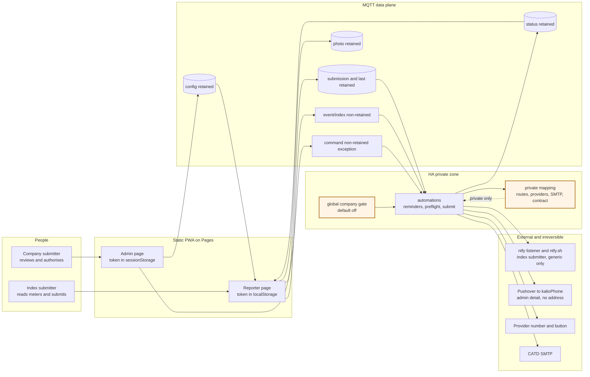

### 2.1 Trust boundaries

| Boundary | What crosses it | Control that must hold | Current weakness |
|---|---|---|---|
| **B1 — link to browser** | Reporter token and installation id | Token only in the URL fragment; stored locally; URL stripped immediately | Source now rejects a query token, but this has no automated negative test and no live invite check |
| **B2 — browser to MQTT** | Readings, photos, event, config, command | Origin-locked reporter/admin tokens; ACLs limit topics | Admin token is all-powerful; `submitted_by` is client-asserted; the live reporter token lacks the `event/index` ACL |
| **B3 — MQTT to HA** | Data, status, command | No secrets, routes, SMTP, contract data, or address in retained config | Schema 3 strips `address` on normalize and the live retained config was cleaned; the runbook still records a schema-2 config and HA cannot stop a direct schema-2 publisher |
| **B4 — HA to notifications** | Titles, messages, links | ntfy generic/PII-free; Pushover admin detail allowed but no address; bare URL only | Split wrappers imported; generic ntfy title and rejected `#`/`?` URL observed; full ntfy/Pushover capture pending |
| **B5 — HA to provider/CATD** | Approved index or contract email | Explicit approve + global gate + window + status guards | Button press is irreversible; timeout is recorded as `forwarded`; stuck `sending` has no watchdog |
| **B6 — approval command** | Approve/suppress | Non-retained, fresh, status re-checked, queued | Fire-and-forget: the page gets a PUBACK, not an HA acknowledgement |

**Critical reading of B6.** The MQTT namespace is described as "data only", but the approve/suppress
command is a **human control message** travelling over MQTT. That is a deliberate exception, not a
property of the data plane. Either the project stops claiming a strictly data-only MQTT namespace,
or the command moves to HA (dashboard/script or authenticated webhook) and the admin page becomes
read-only for company actions. **Recommendation:** if "data-only MQTT" is a hard product property,
move approve/suppress to HA and keep MQTT read-only for company actions. If one-page approval is
more important, keep the command but call it an explicit control exception and add an
acknowledgement/timeout. See §6, question Q6.

---

## 3. Flows

**Reading convention.** "Happy path" is the intended product behavior. "Failure and edge paths"
include both inherent edge cases and current implementation gaps. Where the code does not yet
match the happy path, the gap is named explicitly rather than hidden in the diagram.

### F1 — First access, invite link, token stored, URL stripped

**User story.** As the company submitter, I want to invite the index submitter with one link that
stores the credential on her device and leaves no token in the address bar, so that she can report
without a login and without leaking the token.

**Trigger.** The owner generates an invite, or the index submitter opens an invite link.

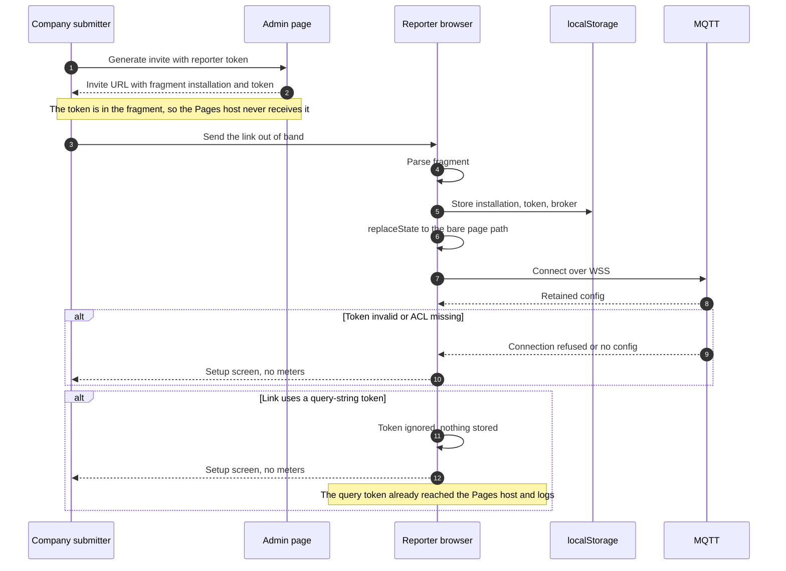

**Happy path.** The link is opened once. The page parses `token` from the fragment, writes it with
the installation and broker to `localStorage`, immediately calls `history.replaceState` with the
bare path, connects to MQTT over WSS, and renders the retained config. `installation` and `broker`
may also come from the query string because they are not credentials; the token may not.

**Failure and edge paths.**

- **Query-string token.** `js/common.js` accepts the bearer token only from the fragment, so a
  `?token=` invitation produces the setup screen rather than a stored session. The token has
  already reached the Pages host and logs, so it must still be treated as leaked and rotated.
  This rejection is coded but has no automated negative test.
- **JavaScript disabled, CSP failure, or old browser.** The URL cannot be stripped without JS. The
  fragment still never reaches the server, but the token remains visible in the address bar and
  history. The invite should say "open once, then bookmark the bare page".
- **Shared Pages host.** `localStorage` is shared by every project on the same host. A token stored
  under a generic key is readable by another project on that host. Use a dedicated host or a
  project-specific key, and never load third-party scripts.
- **Wrong or expired token.** The page shows the setup screen and no data. The error should not
  reveal whether the installation exists.
- **Installation mismatch.** If the link says one installation but the token belongs to another,
  the page may normalize the config under the link's installation id. The page should validate
  that the token's scope matches the requested installation before publishing or subscribing.
- **Lost device or leaked link.** There is no remote logout. The only remedy is token rotation and
  a new invite. Treat the invite as a password.
- **Admin session.** The admin token is in `sessionStorage`, so closing the tab logs out. The
  reporter token persists in `localStorage` by design.

**Privacy invariant `[PRIV]`.** The reporter token must never appear in an ntfy/Pushover title,
message, or URL. Notification links are bare page URLs. The installation id is an identifier and
must not be in a notification either.

**Recovery and audit `[AUDIT]`.** Flespi token list, token expiry date, and rotation record. Clear
the stored token from the device, rotate the reporter token, and re-invite. Browser history and
Pages access logs are the only trace of a leaked query token; assume compromise and rotate.

---

### F2 — Normal index-submitter reporting

**User story.** As the index submitter, I want a meter card that tells me whether I can submit,
warns me when a value looks wrong, and lets me attach a photo, so that I can report confidently
from my phone without understanding the range math.

**Trigger.** The reporting window is open (or the submission is late), the meter is `manual`, and
the index submitter enters an index.

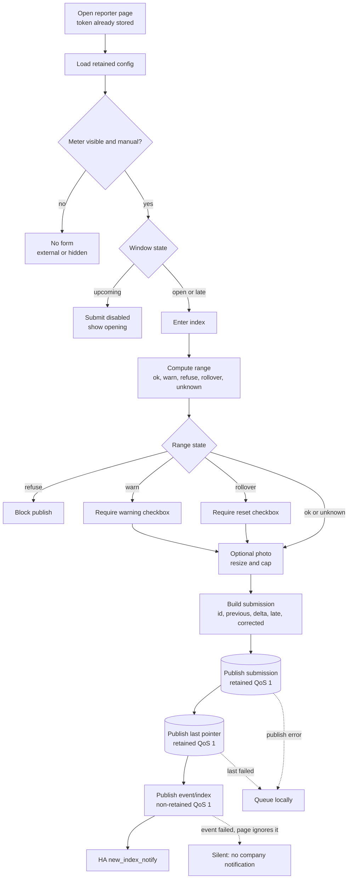

**Happy path.** The page calculates the period from the window opening month, prorates expected
consumption from the last accepted submission or baseline, and classifies the value as `ok`,
`warn`, `refuse`, `rollover`, or `unknown`. A warning needs a checkbox; a rollover needs an
explicit reset confirmation; a refusal cannot be published. The submission is retained per
meter+period, then the `last` pointer is retained, then a non-retained `event/index` is published.
HA's `new_index_notify` consumes the event.

**Failure and edge paths.**

- **Upcoming window.** The submit button is disabled; the card should show when the window opens.
- **Late submission.** Accepted with `late: true`; it still stops reminders. The period is the
  month in which the window opened, not the month of submission.
- **No window.** `window: null` accepts a submission at any time; the period is the current month.
- **Invalid value.** Empty, negative, or non-numeric values are rejected before publish.
- **Refusal.** A refused value never becomes a baseline and cannot be published without an
  explicit override. The current UI blocks it.
- **Warning.** The value can be submitted after confirmation and can become the next baseline.
- **Rollover/reset.** A value below the baseline is treated as a meter reset, not normal
  consumption; it requires explicit confirmation and becomes the new baseline.
- **Unknown range.** A first reading with no baseline or no typical consumption is accepted without
  a range.
- **Photo.** The client resizes and caps the image. If the photo fails after the index is accepted,
  the reading is kept with `photo: false`; the reading must never be lost for the image.
- **Correction without a new photo.** The page clears the old retained photo so a `photo: false`
  submission does not keep a stale image. This is coded.
- **Publish error.** The item is queued locally. If the `last` pointer fails, the item is queued
  even though the submission was retained.
- **Event failure.** The page ignores `eventOk`. The reading is safe, but the company submitter may
  never be notified. This is a silent failure and a P0 gap (§5).
- **Event before proposal.** The notification can arrive before HA preflight has written the
  retained `proposed` status. The admin opens the page and sees no proposal yet. This is a UX race,
  not data loss.
- **Correction race.** A correction overwrites the same meter+period topic. An old proposal remains
  `proposed` until preflight runs again; an approval carrying the old index is rejected by HA.
- **Two devices.** Two devices can submit the same meter+period. The last retained write wins, with
  no conflict warning. A stale queued reading can overwrite a newer correction.

**Privacy invariant `[PRIV]`.** The MQTT submission may contain `house_id`, `meter_id`, index,
period, and timestamps; that is the data plane. It must not contain a physical address, house
address, contract data, client code, or token. Notifications must not contain the meter name,
house name, index, or period. A photo can show an address or house number; see §6, Q16.

**Recovery and audit `[AUDIT]`.** The retained submission topic is the record; history is the set of
retained `submission/#` topics. A correction is an overwrite with a new `submitted_at`. The `last`
pointer is the fast "what was reported?" answer. Backups include the retained topics.

---

### F3 — Offline submission and queue flush/reconciliation

**User story.** As the index submitter, I want my submission to survive a bad connection, so that I
do not have to remember or re-enter the reading at the meter.

**Trigger.** The device is offline, the MQTT connection drops, or a publish fails.

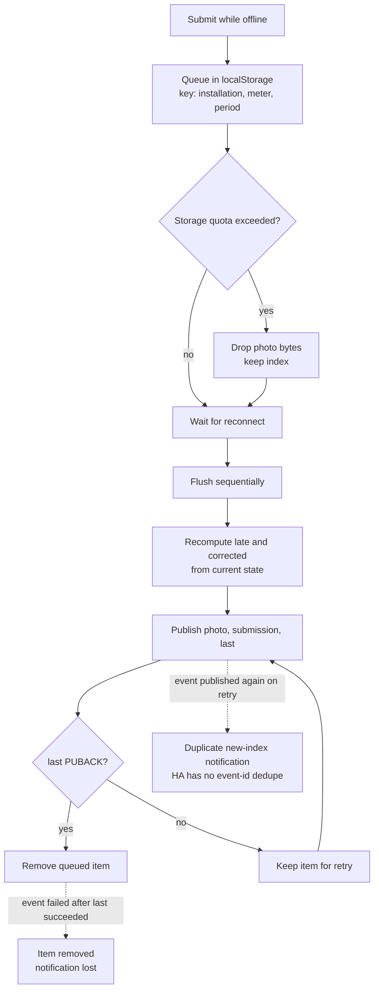

**Happy path.** The queue is keyed by installation+meter+period, so a newer attempt for the same
meter+period replaces the older one. On reconnect the page flushes sequentially, recomputes `late`
and `corrected` from current state, publishes the photo (if any), the submission, and the `last`
pointer, and removes the item only after the pointer publish succeeds.

**Failure and edge paths.**

- **Storage quota.** The page drops the photo bytes and keeps the index. If the queue still cannot
  be written, the user sees an error and the reading is lost. There is no export path.
- **Private mode or cleared browser data.** The queue is gone. The user must re-enter the reading.
- **Queue is device-local.** It does not sync across devices. A reading queued on one phone is
  invisible on another.
- **Last-writer-wins across devices.** Device A queues an old index; device B submits a correction;
  device A reconnects later and overwrites the correction. There is no `submitted_at` comparison
  or conflict warning. This can submit the wrong index.
- **Duplicate event on retry.** If the `last` pointer fails, the item stays queued. The next flush
  republishes the submission (same topic, idempotent) and the `event/index` (non-retained, not
  idempotent). HA has no event-id dedupe, so the company submitter can receive duplicate
  notifications.
- **Event lost after success.** If the submission and `last` succeed but the event fails, the item
  is removed. Nothing retries the event. The reading is safe; the notification is lost.
- **Expired token or ACL.** Flush keeps failing. There is no dead-letter state, no visible queue
  age, and no alert. The queue can grow silently.
- **Multiple tabs.** Two tabs can flush the same queue concurrently. There is no lock, so duplicate
  publishes and duplicate events are possible.
- **QoS 1 is not durability.** PUBACK means the broker accepted the packet, not that a retained
  write survived a restart. With Mosquitto persistence disabled, a broker restart can lose the
  reading even though the page showed success.

**Privacy invariant `[PRIV]`.** The queue lives in `localStorage` and can contain meter id, index,
period, and base64 photo bytes. It must not contain an address or contract data. On a shared
device, the queue is readable by anyone with the browser profile.

**Recovery and audit `[AUDIT]`.** Inspect the browser's local queue (currently only via developer
tools), the retained submission topic, and the admin history. Add a visible queue age and a safe
"clear queue" action. A queue flush is not an audit trail; the retained topic is.

---

### F4 — Reminder and close-alert flow

**User story.** As the index submitter, I want a reminder while the window is open; as the company
submitter, I want an alert when a window closes unreported, so that no period is silently missed.

**Trigger.** HA time trigger at 10:00 for reminders; 10:05 for the close alert.

```mermaid
sequenceDiagram
  autonumber
  participant HA as HA scheduler
  participant CFG as Config and private routes
  participant SUB as Last-submission sensor
  participant IS as Index submitter
  participant N as notify_admin (Pushover)
  participant CS as Company submitter
  HA->>CFG: 10:00 read meters and routes
  loop Each meter
    HA->>HA: Skip external or no window
    HA->>SUB: Read last reported period
    alt Unknown or unavailable
      HA->>HA: No reminder
    else Known and different period
      alt index_submitter route
        HA->>IS: ntfy reminder, generic only
      else company_submitter route
        HA->>N: Reminder request
        N->>CS: Pushover detailed, no address
      end
    end
  end
  Note over N,CS: notify_admin is Pushover-only; notify_index_submitter is ntfy-only
```

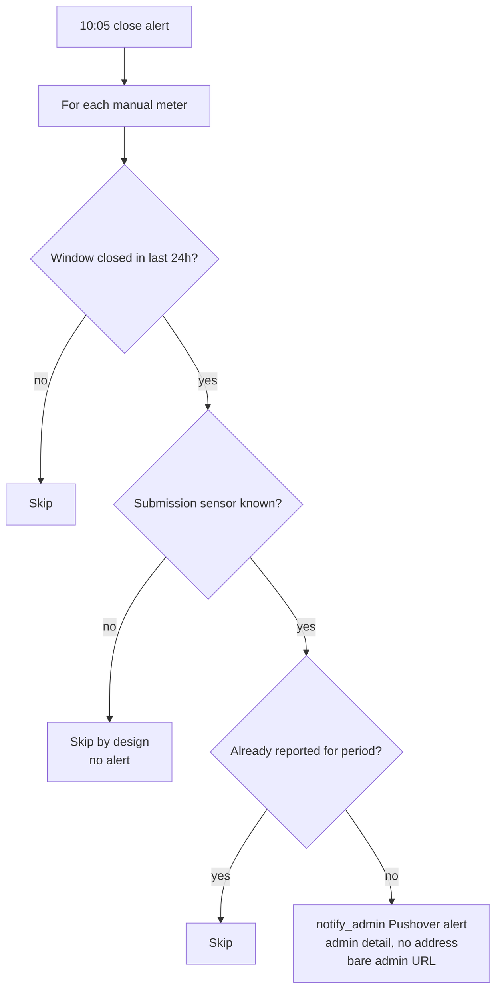

**Happy path.** At 10:00 HA reads the retained config and the private routes. It skips
`reading_mode: external` meters and meters with no window. It reads the last-submission sensor;
only a known, different period is due. A meter routed to `index_submitter` calls
`script.notify_index_submitter` (generic ntfy with **Open index reporting page**). A meter routed
to `company_submitter` calls `script.notify_admin` (Pushover to `kalioPhone`, operational detail
allowed, no address). At 10:05 the close alert sends one company-submitter Pushover message if a
window closed in the last 24 hours and the meter is still unreported. A late submission still counts and stops
reminders.

**Failure and edge paths.**

- **Unknown sensor.** If the last-submission sensor is missing, `unknown`, or `unavailable`, HA
  treats the meter as **unknown**, not unreported, and sends no reminder. This avoids false
  reminders, but a broken discovery entity silently suppresses reminders forever. There is no
  health alert for "open window + unknown sensor".
- **Missing route.** A missing `routes.<meter>.target` defaults to `company_submitter`. A typo can
  silently misroute the reminder to the owner instead of the mother.
- **Duplicate private mapping sensor.** If HA creates a second mapping sensor, automations may see
  an empty mapping. All routes then default to `company_submitter`; company actions find no
  provider data. There is no startup alarm for this.
- **HA down at 10:00 or 10:05.** Time triggers do not catch up. A restart after the trigger time
  skips that day entirely. The close alert only looks back 24 hours.
- **ntfy failure.** `continue_on_error` lets the loop continue, but the index submitter may miss
  the reminder. The company submitter is not told that the mother's ntfy delivery failed.
- **ntfy listener down.** The index-submitter envelope is non-retained and is lost; the admin
  Pushover path is independent. There is no retry.
- **Admin Pushover fails.** `notify_admin` raises; callers in the loop may use `continue_on_error`,
  so the loop continues without a delivery guarantee. The HA trace is the only evidence.
- **Timezone.** Window math uses HA's local time. If HA is not on `Europe/Bucharest`, open/close
  calculations are wrong even though the config says Bucharest.
- **Caller detail is split by channel.** The admin Pushover caller still builds house/meter/index/
  period detail; that is allowed. The mother path must use the generic `notify_index_submitter`
  wrapper. Do not route the admin detail through ntfy.
- **No complete captured envelope.** The split wrappers are imported live; a generic ntfy title
  and a rejected `#`/`?` URL were observed. The admin Pushover body and the full app flow still
  need capture.

**Privacy invariant `[PRIV]`.** The index-submitter ntfy path must be generic: no house/meter
name, index, period, close date, address, contract/client code, token, installation id, or other
identifier. The company-submitter Pushover path may contain operational detail, but never an
address, token, or installation id. Both paths use bare URLs; `notify_admin`, `ntfy_notify` and
`tools/ntfy.js` enforce the link shape.

**Recovery and audit `[AUDIT]`.** HA automation trace, ntfy listener log, Pushover delivery,
bridge heartbeat, and `npm run healthcheck`. Run the reminder automation manually while a window
is open to test. Add a startup catch-up and an "unknown sensor" health alert.

---

### F5 — New-index notification from index submitter to company submitter

**User story.** As the company submitter, I want a notification when a new index is waiting, with
no private data in the notification, so that I can review it from a lock screen without exposing
the household.

**Trigger.** The index submitter successfully publishes a submission and then publishes the
non-retained `event/index`.

```mermaid
sequenceDiagram
  autonumber
  participant IS as Index submitter page
  participant M as MQTT
  participant HA as new_index_notify
  participant N as notify_admin
  participant CS as Company submitter
  IS->>M: event/index QoS 1 non-retained
  M->>HA: Deliver event
  alt HA is offline at event time
    M-->>HA: No subscriber, event is lost
    Note over M,HA: Preflight does not notify, so there is no second chance
  else HA online and payload valid
    HA->>HA: Validate meter, period, index, submitted_by
    HA->>N: Notify request
    N->>CS: Pushover detailed, no address, bare admin URL
  end
  IS->>M: Queue flush republishes event
  M->>HA: Same event id again
  HA->>CS: Duplicate notification, no id dedupe
  Note over N,CS: Pushover detail is allowed; ntfy is not used for admin
```

**Happy path.** The event carries `v`, `id`, `meter_id`, `period`, `index`, `submitted_by`, and
`submitted_at`. HA validates the shape and the role, then calls `script.notify_admin` with a bare
admin URL. Pushover to `kalioPhone` carries the operational title/message (meter, house, index,
period) but no address. The owner opens the admin page and sees the proposal.

**Failure and edge paths.**

- **Event lost while HA is offline.** The event is non-retained. If HA is down or disconnected at
  publish time, there is no replay. `company_preflight` may still write a `proposed` status when it
  sees the retained `last` pointer, but it deliberately does not notify. The owner may never know.
- **Event publish fails.** The reporter page ignores `eventOk`. The reading is retained; the
  notification is silently lost.
- **Reporter token ACL.** If the reporter token lacks publish permission on `event/index`, the
  event fails. The runbook records that the live token lacks that ACL and must be re-minted. Until
  then, the notification path is not live. This is a live-only blocker (C8/G11), not a source
  defect.
- **Duplicate event.** A queue flush can republish the same event id. HA has no event-id dedupe.
  The owner gets duplicate notifications.
- **Malformed event.** HA's condition filters it silently. There is no alert that an event was
  rejected.
- **Role spoofing.** `submitted_by` is client-asserted. A reporter token can publish
  `company_submitter` and change the role label. Topic ACLs, not payload values, are the real
  control.
- **Race with preflight.** The notification can arrive before the retained proposal exists. The
  owner opens the admin page and sees nothing yet. This is confusing but not data loss.
- **New tab or device.** The notification cannot carry the admin token. On a new tab or a device
  without a stored admin session, the bare link opens the setup screen; the owner must enter the
  token manually. That is the privacy tradeoff, and it should be documented in the invite
  instructions.
- **PII scope is explicit.** `new_index_notify` computes house/meter/index/period detail and sends
  it to the admin through Pushover, which is allowed. The admin message must never contain an
  address. The index-submitter ntfy path is generic.
- **Detail strings still exist.** The event payload and the admin Pushover caller contain
  identifiers. That is allowed in HA and Pushover, but any future direct `ntfy_notify` call that
  bypasses `notify_index_submitter` would leak them to ntfy.

**Privacy invariant `[PRIV]`.** The notification title, message, action label, and URL must not
contain the house name, meter name, index, period, contract/client code, token, installation id, or
any identifier. The URL must be the bare admin page. The event itself may carry the data; HA must
not forward it to ntfy. `notify_index_submitter` uses only generic text; `notify_admin` sends admin
detail to Pushover and never to `status/ntfy`. The ntfy envelope remains generic.

**Recovery and audit `[AUDIT]`.** HA automation trace, MQTT broker log, and the retained
`proposed` status. A better design is to notify on the retained `proposed` transition, not on the
non-retained event; that removes the loss/duplicate class. If the event stays, add an event-id
dedupe and a visible failure path.

---

### F6 — Company submitter review, freshness checks, approve/suppress, gate

**User story.** As the company submitter, I want to review the exact proposal and explicitly
approve or suppress it under a hard global gate, so that nothing is sent to a provider by accident
and I never approve the wrong index.

**Trigger.** A `last/<meter>` pointer changes; `company_preflight` writes a retained `proposed`
status; the owner opens the admin page and presses **Aprobă** or **Suprimă**.

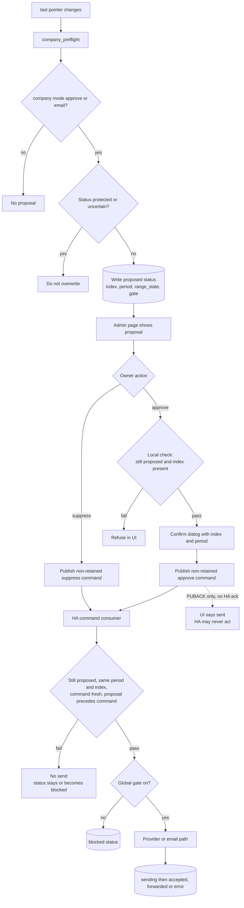

**Happy path.** `company_preflight` writes a retained `proposed` status only when the private
company mode is `approve` or `email`, the status is not already protected, the submission sensor
period and index agree with the last pointer, and the meter is not external. The admin page shows
the proposal, index, period, range state, and gate state. On approve, the page publishes a
non-retained, QoS 1 command with the index and a timestamp. HA re-checks that the retained status is
still `proposed`, the period and numeric index match, the command is at most 10 minutes old, the
proposal was written before the command, and the global gate is on. Then it enters the provider
or email path.

**Failure and edge paths.**

- **Protected status.** `accepted`, `forwarded`, `suppressed`, and `sending` are not overwritten.
  An `error` with `uncertain: true` is also protected from automatic re-proposal.
- **Missing submission sensor or index mismatch.** Preflight silently writes no proposal. The
  owner may have received a new-index notification but see nothing to approve.
- **Gate off.** Approve writes a retained `blocked` status. Turning the gate on later does **not**
  re-propose on its own; only a new `last` pointer, or an HA replay of the retained pointer on
  restart, can. The owner must wait or run a manual re-arm. This is a silent dead-end.
- **Window closed.** Email mode writes `blocked` with "outside the email reporting window".
  Provider mode writes `blocked` when the provider window sensor is closed. Again, there is no
  automatic re-propose when the window opens.
- **Command lost.** The page gets a PUBACK from the broker, not an acknowledgement from HA. If HA
  is offline, restarting, or subscribed to the wrong topic, the command is lost and the UI still
  says "Aprobare trimisă către HA." There is no timeout that says "HA did not acknowledge."
  Non-retained is the correct choice for preventing replay/double-submit, but it also means there
  is no offline queue for approvals.
- **Stale command.** The page can hold an old proposal in memory. HA rejects a mismatched index or
  a command older than 10 minutes and sends an admin notification. The owner sees the rejection
  only if the notification is delivered and read.
- **Double approval.** Two tabs or a double click publish two commands. `mode: queued` serializes
  them; the second sees the status no longer `proposed` and is refused. This is coded.
- **Suppress after send.** Suppress refuses to overwrite `accepted` or `forwarded`, so it cannot
  hide a send that already happened. It writes a durable retained `suppressed` status with
  `cancelled_at`.
- **Suppress during a stuck `sending`.** The suppress guard only protects `accepted` and
  `forwarded`. If HA is stuck in `sending` after an SMTP or provider action, a suppress can
  overwrite `sending` with `suppressed` and the notification says the index was not sent. That may
  be false. This is a P0 edge.
- **Correction race.** A correction changes the index but the old proposal remains `proposed`
  until preflight runs. An approval carrying the old index is rejected. That is safe, but the
  owner's confirmation dialog may show the old value.
- **Status retained loss.** If the retained status topic is deleted or lost, the guards disappear.
  A later approve may send again. Status topics must be treated as durable records.
- **Admin UI gate state.** The page shows the gate value but does not disable approve when the gate
  is off. The owner can confirm a command that is guaranteed to be blocked. This is not dangerous,
  but it is not dummy-proof.

**Privacy invariant `[PRIV]`.** The admin page may show details on screen. Admin Pushover messages
may carry operational detail, never an address. The index-submitter ntfy path remains generic;
never route admin detail through ntfy. Details also remain in the HA trace and on-screen log.

**Recovery and audit `[AUDIT]`.** The retained status topic, HA automation trace, and provider
portal or SMTP sent folder. Add a safe re-arm procedure for `blocked`/`error` and a startup check
for stale `sending`. Never delete a status topic as a casual retry; treat it as an auditable state
transition.

---

### F7 — Provider number/button submission and confirmation/failure

**User story.** As the company submitter, I want the provider submission to use the approved index
and tell me honestly whether it was confirmed, so that I do not mistake a button press for a
confirmed reading.

**Trigger.** An approve command for a meter whose private company mode is `approve` (provider
number/button), with the global gate on and the provider window sensor open.

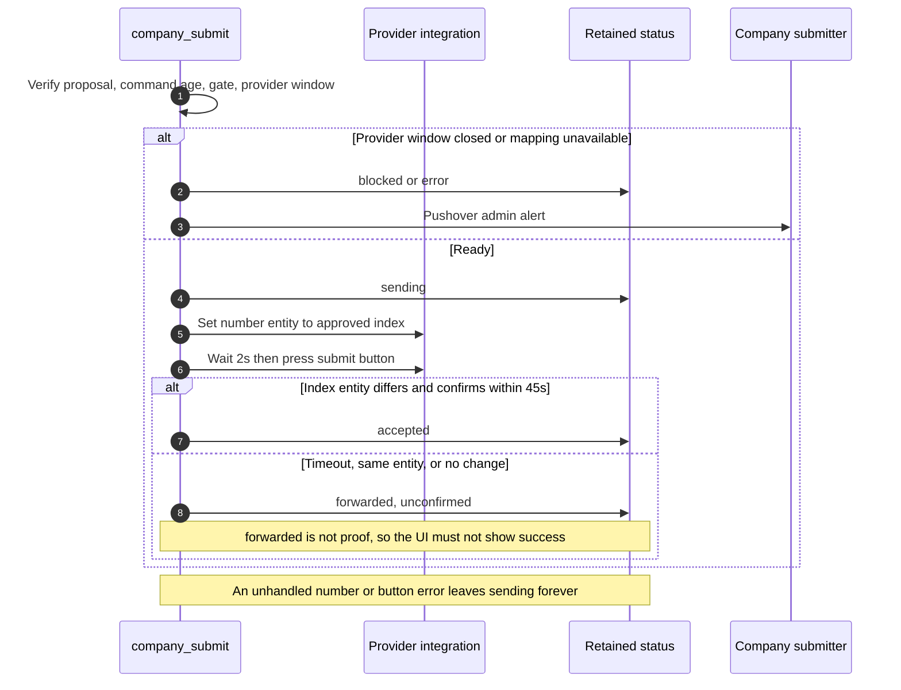

**Happy path.** HA verifies the proposal, command age, gate, and provider-window sensor. It writes
a retained `sending` status, sets the provider number entity to the approved index, waits two
seconds, presses the submit button, and waits up to 45 seconds for the provider index entity to
reach the approved value. If the index entity differs from the number entity and changes, HA writes
`accepted`. If the index entity is the same as the number entity, or the wait times out, HA writes
`forwarded` and tells the owner to verify in the provider portal.

**Failure and edge paths.**

- **Provider window closed.** The provider-window sensor is false or unavailable; HA writes
  `blocked` and does not press the button.
- **Incomplete mapping.** Missing number, button, or index entity, or an entity marked
  `unavailable`, produces `error` and an admin alert.
- **Number or button action fails.** The `number.set_value` and `button.press` actions are not
  wrapped in error handling. If either raises, the automation stops with the retained status still
  `sending`. There is no error status and no notification. The owner sees a permanent "sending"
  badge. This is a P0 silent failure.
- **Button pressed, no confirmation.** The 45-second wait times out; HA writes `forwarded`. A
  timeout and a successful provider acceptance can look the same in the admin UI unless the detail
  text is read. `forwarded` is not success.
- **Same entity.** If the provider index entity is the same as the number entity, HA cannot
  distinguish "we set it" from "the provider accepted it". It records `forwarded`, never
  `accepted`. This is honest in the payload but easy to misread in the UI.
- **Provider accepted but no index update.** The provider may accept the reading but not update the
  index entity. HA records `forwarded`; the owner must check the portal.
- **Button side effects.** A button press can be irreversible and provider-specific. HA cannot
  know whether a retry would double-submit. The design avoids automatic retry, but a manual
  re-approve after a stuck `sending` can.
- **HA restart mid-send.** The automation does not resume. The status remains `sending`. There is
  no startup watchdog.
- **Suppress mid-send.** A suppress command queued during the send waits for the automation to
  finish, then sees `accepted`/`forwarded` and is refused. If HA crashed and the status is stuck
  `sending`, suppress can overwrite it (see F6).

**Privacy invariant `[PRIV]`.** The provider receives the index; the provider mapping is private
HA data, never MQTT. The admin Pushover notification may carry operational detail (meter, index,
period, status) but never an address, contract code, token, or installation id. The link is the
bare admin page. The index-submitter ntfy path remains generic.

**Recovery and audit `[AUDIT]`.** Provider portal, HA automation trace, retained status detail, and
the owner's manual confirmation. A stuck `sending` requires mailbox/portal verification before any
status reset. Add an explicit `accepted` vs `forwarded_unconfirmed` distinction and a startup
watchdog for stale `sending`.

---

### F8 — CATD email submission, window, idempotency, uncertain failure

**User story.** As the company submitter, I want CATD email to be one explicit, window-checked,
idempotent action with an honest uncertain state, so that I never send twice or send outside the
contract window.

**Trigger.** An approve command for a meter whose private company mode is `email`, with the global
gate on, a configured CATD window, and private contract data present.

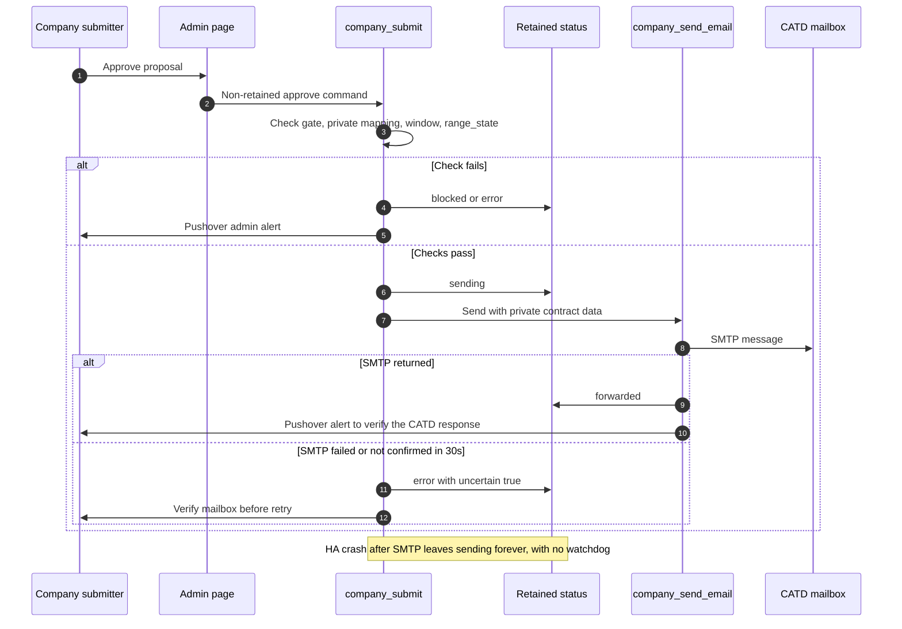

**Happy path.** HA verifies the global gate, the private mapping (SMTP service, contract holder,
private CATD contract address, client code), the CATD window for the period, the range state, and
that the proposal is still `proposed` with the same index. It writes a retained `sending` status,
calls the email script, and writes `forwarded` only after the SMTP call returns. The email contains
the contract holder, the complete address, client code, old and new index, and the reading date.
That address exists only in the HA-only mapping and the outbound email; it is never written to
MQTT, the app, or ntfy. The owner gets an admin Pushover alert to verify the CATD response; that
alert never contains the address or client code.

**Failure and edge paths.**

- **No window.** A CATD meter with no window is refused by design; status `blocked`.
- **Outside the window.** The check uses the full open/close date, time, and period, not just the
  day of month. A late approval is blocked.
- **`range_state: refuse`.** Blocked. `ok`, `unknown`, and `warn` are allowed only through the
  explicit approve command. An unknown or malformed range state produces `error`.
- **Incomplete private mapping.** Missing SMTP service, contract holder, contract address, or
  client code produces `error` and an admin alert. The email body is never rendered with
  placeholders.
- **SMTP failure or no confirmation.** HA writes `error` with `uncertain: true` and notifies the
  owner to verify the mailbox before any retry. `company_preflight` refuses to overwrite an
  uncertain error. This is the right safety posture.
- **HA crash after SMTP.** The status remains `sending` forever. There is no startup watchdog and
  no automatic retry. The owner must verify the mailbox manually.
- **Forwarded write fails.** If SMTP returns but the retained `forwarded` write fails, the caller
  times out and writes `error` with `uncertain: true`. The email may have been sent. This is
  conservative but can lead to a duplicate if the operator retries without checking.
- **Status retained loss.** If the `sending`/`forwarded`/`suppressed` status topic is deleted or
  lost, the idempotency guard disappears. A later approve can send again. Status topics are part
  of the safety case, not disposable UI state.
- **Suppress during stuck `sending`.** As in F6, suppress can overwrite `sending` and claim the
  index was not sent. If the SMTP call already happened, that claim is false.
- **No delivery confirmation.** `forwarded` means the SMTP service accepted the message, not that
  CATD processed it. The app cannot see bounces or CATD replies. The owner must watch the mailbox
  or a later bill.
- **Window and cadence assumptions.** The example window is not the contract. CATD household
  meters may be quarterly. An incorrect window can block legitimate sends or allow a send outside
  the contract.
- **Email reading date.** The body uses the send time, not necessarily the time the index was read.
  If the contract requires the reading date, this is wrong.
- **Unnecessary meter name in the email.** The body includes the app's meter display name, which
  may be a house label. The contract code and address already identify the account; minimize this
  if CATD does not require it.

**Privacy invariant `[PRIV]`.** The CATD email necessarily contains the contract holder, address,
client code, and index; that is the purpose of the channel. Those values must live only in the
private HA mapping and the email body, never in MQTT, Git, the app UI beyond the owner's private
session, or ntfy. Admin Pushover alerts may carry operational detail but never the contract
address or client code.

**Recovery and audit `[AUDIT]`.** SMTP provider sent folder, CATD mailbox, HA automation trace, and
the retained status (index, period, timestamps, uncertainty). Test only against the owner's mailbox
until the real contract data is filled and the owner explicitly approves a CATD send. Do not use
placeholder names, addresses, or codes in a message to CATD.

---

### F9 — External/smart meter source, water watcher, no reporter form

**User story.** As the company submitter, I want external meters to report without a reporter form
and water changes to notify me, without creating fake submissions or asking the index submitter to
enter a value she cannot read.

**Trigger.** A meter is configured `reading_mode: external`, or a private `sources` entity changes
state.

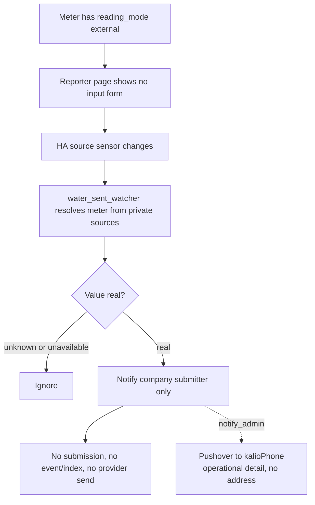

**Happy path.** The reporter page shows the meter but no input form. Reminders and the close alert
skip external meters. The water sent watcher listens for `state_changed`, resolves the entity
through the private `sources` mapping, ignores unknown/unavailable values, and reports the first
real value as "prima valoare". It only notifies; it never sets a provider entity or publishes a
submission.

**Failure and edge paths.**

- **No watcher for electricity/gas.** The water watcher is water-specific. An external electricity
  or gas meter may have no notification path at all; that is acceptable only if the owner does not
  expect one.
- **Misconfigured source.** If the source entity id is wrong, the watcher never resolves the meter
  and sends nothing. There is no startup validation of `sources`.
- **Unknown/unavailable value.** Ignored by design. A sensor that stays unavailable produces no
  notification and no health alert.
- **First value.** Reported as "prima valoare", not a delta. This is correct but easy to misread.
- **Duplicate on restart.** A restored entity can emit a state change on HA restart; the watcher
  may send "prima valoare" again.
- **No submission.** External readings do not create a `submission` or `last` pointer. If the owner
  expects the reporting history to include them, it will not.
- **PII scope is explicit.** The watcher sends house/meter/old-new-delta detail to the admin
  through Pushover, which is allowed. It never sends to ntfy and never includes an address.

**Privacy invariant `[PRIV]`.** The watcher notification goes only to admin Pushover and may
contain operational detail, but never an address; the link is the bare admin page. The index
values are data-plane values and must not be sent to ntfy. The private
`sources` mapping stays in HA. The wrapper enforces the text; no address is available in schema 3
config even if a caller tried to include one.

**Recovery and audit `[AUDIT]`.** HA trace and the source entity history. Add a startup check for
missing `sources` entries and a "sensor unavailable for N hours" alert if the owner relies on it.

---

### F10 — Config publish and schema-2 → schema-3 migration

**User story.** As the company submitter, I want to migrate the retained config without losing
routing or provider mappings, and roll back if one full cycle fails.

**Trigger.** The owner migrates from schema 2 to schema 3 or publishes a config change.

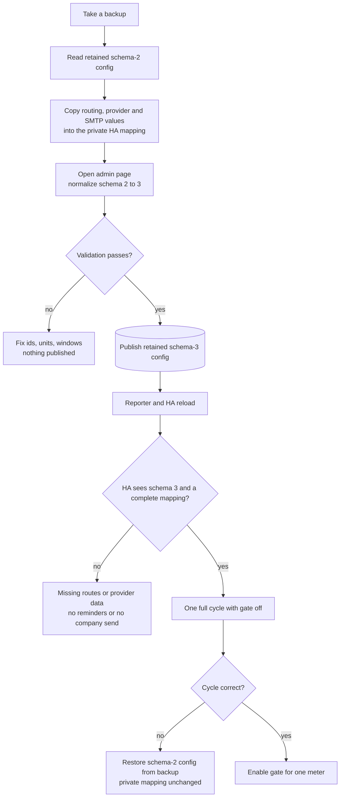

**Happy path.** The browser normalizes a schema-2 config: `houses[].address` is deleted;
`reporting: smart|sensor` becomes `reading_mode: external`, otherwise `manual`; `notify`,
`reporting`, `source`, `forwarding`, and `notifications` are dropped from the MQTT payload. The
owner has already copied those values into the private HA mapping. The admin page validates ids,
units, precision, windows, thresholds, and photo limits, then publishes the retained schema-3
config with a fresh `updated_at`. The reporter and HA reload. One full cycle runs with the gate off
before any company submission.

**Failure and edge paths.**

- **No backup first.** The old retained config is the rollback source. Without it, a bad migration
  is hard to reverse.
- **Copy after publish.** If the private mapping is not populated before the schema-3 config is
  published, routing and company data are gone from MQTT and absent from HA. Reminders default to
  `company_submitter`; company actions find no provider data.
- **HA package deployed before the config.** HA expects schema 3 and a private mapping. Deploying
  in the wrong order produces empty routes and no company actions.
- **Client-side normalization only.** `RCSchema.normalize` runs in the browser. An old client or a
  direct MQTT publisher can still write schema-2 fields to the retained topic. There is no
  server-side schema validation.
- **Validation gaps.** The validator checks ids, units, windows, thresholds, and photo limits, but
  it does not prove that the private mapping is complete. The normalizer deletes `address` rather
  than rejecting it, so a direct publisher can still write the field to retained MQTT; HA has no
  schema check that would reject it.
- **Reporter token ACL.** The reporter token must be re-minted to publish `event/index`. Without
  that, the new-index notification is not live even though the config is schema 3.
- **Duplicate private mapping sensor.** If HA creates `..._2`, automations may read an empty
  mapping. There is no startup alarm.
- **Rollback order.** Restoring schema 2 while the new HA package is deployed can produce unknown
  fields and no proposals. Roll back both sides in a known order.
- **`updated_at` is not a version.** Two admin tabs can publish different configs; the last write
  wins. There is no compare-and-swap.

**Privacy invariant `[PRIV]`.** Schema 3 must not contain a physical address. The schema example,
seed, admin UI, reporter UI, and domain glossary no longer define `houses[].address`, and the
normalizer deletes it on load, so the code path now matches the constraint. The CATD contract
address exists only in the private HA-only `sensor.meter_operations` mapping and must never be
published to MQTT, displayed by the app, or sent to ntfy/Pushover. The remaining live task is to
republish the retained config so the old field is actually removed from the broker, not merely
dropped in the browser.

**Recovery and audit `[AUDIT]`.** Backup JSON, retained config `updated_at`, old config kept until
one full cycle succeeds, and HA traces. A rollback is a config publish, not a code change.

---

### F11 — Token rotation, backup, restore failure paths

**User story.** As the owner, I want credential rotation and backups to be reversible and tested,
so that a lost token, leaked topic, or broker restart does not lose the reporting history.

**Trigger.** Scheduled rotation, suspected leak, device loss, broker migration, or disaster
recovery.

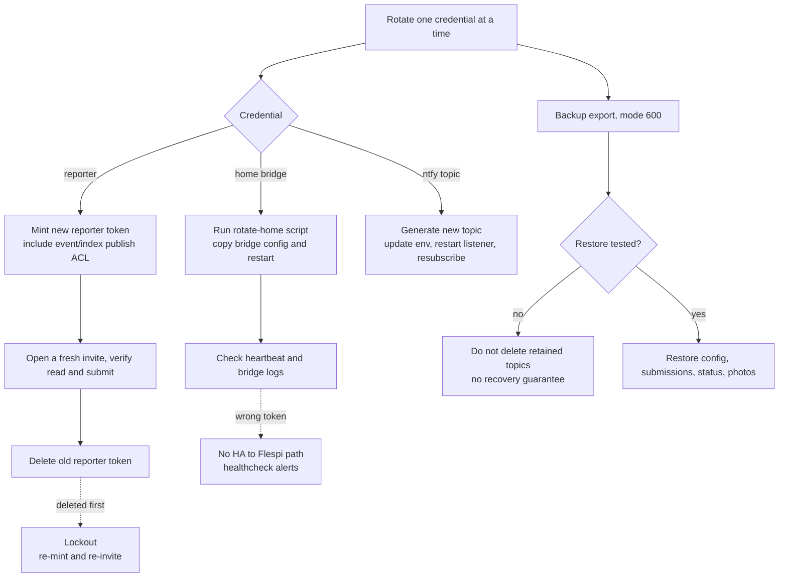

**Happy path.** Rotate one credential at a time: create the new token, verify it on the real path,
then delete the old one. The reporter token includes publish rights for submissions, last, photos,
and `event/index`. The home bridge token is rotated with the script, the bridge config is copied to
the broker host, Mosquitto restarts, and the heartbeat is checked. The ntfy topic is rotated by
generating a new UUID, updating the local env file, restarting the listener, and resubscribing the
phone. Backups are mode 600 JSON exports under a gitignored directory.

**Failure and edge paths.**

- **Delete old token first.** The reporter or bridge is locked out. Re-mint and re-invite or
  re-render the bridge config.
- **Reporter token missing `event/index`.** The page can submit readings but cannot notify the
  company submitter. The page ignores the event error, so the failure is silent.
- **Wrong home token.** The bridge authenticates with the old token or fails. HA can still write
  local status, but the Flespi path for notifications and remote visibility breaks. The heartbeat
  healthcheck is the detector.
- **ntfy topic rotated without resubscribing.** The phone is subscribed to the old topic and
  receives nothing. The listener logs success for the new topic; the user sees silence.
- **Backup contains PII.** The export includes config, submissions, last pointers, status, and
  photos. Schema 3 no longer defines a house address, but a backup taken before the retained config
  is republished can still contain the legacy field. Photos may show an address. Mode 600 is not
  encryption; the file is only as safe as the host and any copies.
- **No offsite backup.** A host loss loses the only backup. Offsite is deliberately deferred; that
  is a product risk, not an implementation detail.
- **Restore is not automated.** The runbook says not to delete retained topics before a tested
  restore exists. If the broker loses retained data, history may be gone even with a JSON backup,
  because there is no tested import path.
- **Discovery loss.** After a broker or HA restart, discovery payloads may need manual republishing.
  There is no `publish_meter_discovery` script; the JSON files are the recovery source.
- **Mosquitto persistence.** Without `persistence true` and a mounted data volume, retained topics
  and discovery do not survive a broker restart. This is a live-migration task, not a code feature.
- **Master token.** The Flespi master token is never used by a browser or HA. A leaked master token
  is a full-account compromise; rotate it and audit token creation.

**Privacy invariant `[PRIV]`.** Backups are sensitive: they contain meter ids, readings, photos,
and possibly a legacy house address from a schema-2 export. Store them encrypted, restrict access,
and never attach them to a notification or a Git commit. Notification links remain bare.

**Recovery and audit `[AUDIT]`.** Token list and expiry calendar, bridge logs, heartbeat, backup
checksum and restore drill result, and the broker persistence volume. A backup that has never been
restored is a hypothesis, not a recovery plan.

---

## 4. Approval gates before production

**Status legend.** `Yes` = implemented in the repository and code-reviewed; where the live column
applies, it still needs that live evidence. `Partial` = the mechanism exists but a stated invariant
is not met. `No` = not implemented or currently contradicted. `Live only` = cannot be proven from
Git; it must be done on the real broker/HA. `Decision` = the owner must choose.

| ID | Gate: what must be true | Coded today | Live migration only | Product decision |
|---|---|---|---|---|
| G1 | No physical/house address in MQTT or the app; CATD address only in private HA data | **Yes (code)** — schema 3 normalization deletes `houses[].address`; seed, seed-local, admin/reporter UI, glossary, and schema examples do not define it; the live retained config was cleaned | Yes — republish schema 3 so legacy fields are also gone | Resolved — no field remains |
| G2 | No PII in ntfy; Pushover admin detail allowed but never an address; no house/meter/index/period/contract/client/token/installation in ntfy or the `status/ntfy` envelope | **Yes (split wrappers)** — `notify_index_submitter` is generic ntfy; `notify_admin` is Pushover to `kalioPhone`; no admin path uses ntfy | Live wrappers imported; capture one ntfy envelope and one Pushover body | Resolved in source; full envelope evidence pending |
| G3 | Notification URLs are bare: no query, no fragment, no identifier | **Yes (source and listener)** — `notify_admin` and `ntfy_notify` stop on `?`/`#`; `tools/ntfy.js` throws; current call sites use bare URLs | Live scripts imported; invalid-URL path observed; add a repeatable negative test | Resolved in source; test evidence pending |
| G4 | Invite token is fragment-only; URL is stripped; query tokens rejected | **Yes (token)** — `parseParams` reads `token` only from the fragment; a query token is ignored, the setup screen is shown, and the query is stripped; invite generator uses the fragment | One live invite + query-token check | Resolved in source; live check pending |
| G5 | New-index notification is reliable and deduplicated | **Partial** — event exists; no retry, no dedupe, event failure is ignored | — | Yes — event vs proposal trigger |
| G6 | Approval command has an HA acknowledgement or a visible timeout | **No** — page sees PUBACK, not HA action | — | Yes — ack design or move to HA |
| G7 | Approve/suppress is either a documented MQTT exception or moved to HA | **Partial** — non-retained, fresh, guarded, but still a control message in MQTT | — | Yes — strict data-only vs exception |
| G8 | Provider outcome distinguishes confirmed from unconfirmed; no stuck `sending` | **Partial** — `accepted` vs `forwarded`, but timeout is `forwarded` and action errors leave `sending` | — | Yes — state model and UI |
| G9 | CATD idempotency and uncertain failure are safe | **Partial** — retained guards and `uncertain: true`; no stuck-sending watchdog, status loss can duplicate | Yes — test only to owner mailbox | Yes — cadence, window, centre |
| G10 | Schema-2 → 3 migration preserves routing/provider data and has a rollback | **Partial** — normalize/validate/backup exist; private mapping copy and deploy order are manual | Yes — copy mapping, publish schema 3, deploy HA, one cycle | — |
| G11 | Reporter token can publish `event/index` | **No** — runbook says the token must be re-minted | Yes — re-mint and verify in Flespi | — |
| G12 | Private mapping is complete and not duplicated | **Partial** — missing route defaults to company; duplicate sensor can be empty; no startup alarm | Yes — fill real mapping and verify entity | — |
| G13 | Offline queue reconciliation cannot submit a stale/wrong index | **Partial** — queue and sequential flush exist; device-local last-writer-wins | — | Yes — conflict policy |
| G14 | Freshness and status guards hold | **Yes** — command age, proposal age, same period/index, gate, protected statuses | — | Yes — window values |
| G15 | Global gate defaults off and returns off after restart | **Yes** — documented helper behavior | Yes — create/import the helper | — |
| G16 | Unknown sensors do not silently suppress reminders | **Partial** — unknown means no reminder by design; no health alarm | — | Yes — health alert policy |
| G17 | Reminders and close alerts survive HA downtime | **Partial** — only daily time triggers; no catch-up | — | Yes — catch-up policy |
| G18 | Backup/restore is tested and protects sensitive data | **Partial** — mode 600 backup; no automated restore, no offsite, not encrypted | Yes — restore drill, offsite | Yes — retention and encryption |
| G19 | Mosquitto persistence and discovery recovery are proven | **Partial** — documented, not enforced; manual republish | Yes — enable persistence, mount volume, test | — |
| G20 | Health monitoring detects bridge/HA/notification failure | **Partial** — heartbeat healthcheck exists; scheduling is live-only | Yes — schedule on host | — |
| G21 | CATD contract data and explicit approval are in place | **Partial** — code requires mapping; no real data | Yes — fill private data and approve test | Yes — contract holder, private contract address, code, centre |
| G22 | Photos cannot leak an address or house number | **No** — photos are retained and backed up; content is uncontrolled | — | Yes — crop guidance or disable |

### 4.1 The gates that block turning the company switch on

The privacy gates are now code-closed but not evidenced; the reliability gates are still open. In
order:

1. **G1 / C1 (live evidence)** — the retained config was cleaned of `houses[].address`; publish the
   schema-3 config and keep a dump showing no address and no legacy orchestration fields.
2. **G2 / C2 (live evidence)** — import `notify_index_submitter` (ntfy) and `notify_admin`
   (Pushover). Capture the mother reminder as generic ntfy and the admin new-index/close/water/
   company alerts as detailed Pushover; confirm no identifier in the `status/ntfy` payload and no
   address in Pushover.
3. **G3 / G4 / C3 (live evidence + negative test)** — import the listener/scripts, prove a
   `?`/`#` URL is refused, and prove a query-string invite token does not log in.
4. **G5 / C4** — make the new-index notification reliable or replace it with a proposal-based
   trigger.
5. **G6 / C5** — add an approval acknowledgement/timeout, or move approval to HA.
6. **G8 / C6** — make provider confirmation honest and eliminate stuck `sending`.
7. **G9 / C7** — add a CATD stuck-sending watchdog and protect the send ledger.
8. **G11 / C8** — re-mint the reporter token with `event/index`, or remove the event.

G10, G12, G18, G19, and G21 are live-migration gates. They do not require code changes, but they
must be completed and observed before the first real company submission. The runbook still records a schema-2 live config, so G10 remains open even though the schema-3
normalizer is ready and the live address field was removed.

---

## 5. Failure classes: leak, double submit, wrong index, silent failure

| Failure class | Concrete path | Consequence | Current guard | Gap |
|---|---|---|---|---|
| **PII leak in ntfy** | Index-submitter reminder → `notify_index_submitter` → `ntfy_notify` → `status/ntfy` MQTT → listener → ntfy | House/meter/index/period exposed on the mother's lock screen and to MQTT subscribers | `notify_index_submitter` sends fixed generic text; URL guards reject `?`/`#` | Source and live title/URL checks; full message envelope pending |
| **PII at rest** | Old schema-2 backups or photos may still contain an address; the live retained config was cleaned | Address can persist in MQTT, backups, and replicas until the live config is stripped | Schema 3 normalizer deletes the field; seed/UI/glossary/docs no longer define it; backups are gitignored and mode 600 | Republish the retained config; encrypt/offsite backups; photo guidance |
| **Submit twice** | Queue retry republishes `event/index`; CATD status lost/stuck; manual re-approve after uncertain; two tabs | Duplicate notification or duplicate provider/email send | Retained status guards, command queue, uncertain error | Event-id dedupe; send ledger independent of status; ack |
| **Wrong index** | Two devices last-writer-wins; stale queued reading overwrites a correction; old cached proposal | Provider gets an older or wrong reading | HA re-checks proposal index/period | Queue conflict policy; force refresh before approve |
| **Silent failure** | Event lost when HA offline; event publish ignored; approval PUBACK but HA never acts; unknown sensor suppresses reminder; missing discovery; HA down at 10:00/10:05; stuck `sending` | Owner believes a reading was reported or sent when it was not | Some status and trace | End-to-end ack, watchdog, health alerts, catch-up |
| **Wrong period** | Cross-month window; late approval; CATD window check for previous period | Submission or email attributed to the wrong month | Period math and full window check | More edge tests; explicit display of period |
| **Unauthorized action** | Reporter asserts `company_submitter`; admin token holder can approve; leaked invite | Role confusion or unauthorized send | Topic ACLs and token scope | Payload role is not proof; per-user auth if needed |
| **Status loss** | Broker restart without persistence; manual status deletion | Guards disappear; duplicate send possible | Retained status intended as durable | Persistence, backup, audited re-arm only |

---

## 6. Open questions and weak spots

These are written as challenges to the design, not as a backlog. Each one needs an owner decision
or a code change.

1. **Is "no address" absolute?** Yes for MQTT and the app: the field is gone from schema 3, the
   seed, the UI, and the glossary. The CATD contract address is the sole exception and lives only
   in the HA-only private mapping. The open question is now operational: when will the retained
   config be republished and a clean dump recorded? A house label remains allowed only as a
   non-identifying name.
2. **Does "no PII in ntfy" apply to Pushover?** No. Pushover is the admin channel and may carry
   operational detail; ntfy must remain generic. Both paths must never carry an address.
3. **If the admin notification is detailed, is that acceptable on a lock screen?** Pushover is the
   admin channel and may show the meter/index/period to `kalioPhone`; the ntfy reminder stays
   generic. The owner has accepted detail on Pushover. Confirm that no address or client code ever
   enters the message.
4. **Why notify on `event/index` at all?** HA already sees the retained `last` pointer and writes a
   retained `proposed` status. A notification on the proposal transition is naturally idempotent
   and survives an HA restart. The event adds a second message, a non-retained loss path, a
   duplicate path, and a token ACL requirement. Is the event worth keeping?
5. **If the event stays, what is the dedupe key?** `id` is present in the payload, but HA does not
   store it. A per-meter `input_text` or a small persistent store would be needed. Is that
   complexity justified?
6. **Should approve/suppress move to HA?** Keeping it on MQTT preserves the single static-page
   approval UI but makes "data-only MQTT" false. Moving it to HA gives authenticated users and an
   immediate service result, but splits the UI. Which property does the owner value more:
   one-page approval or a strictly data-only namespace?
7. **What does "sent" mean in the admin UI?** Today it means "the broker acknowledged the command",
   not "HA acted". What timeout should the page show before saying "not acknowledged"? Who gets
   alerted if HA never acts?
8. **What does `forwarded` mean to the owner?** It currently covers "button pressed, index
   confirmed", "button pressed, no confirmation", and "same entity, cannot confirm". A green
   success badge is misleading. Do we add `forwarded_unconfirmed`, or make `forwarded` explicitly
   amber and require portal verification?
9. **What happens after `blocked`?** If the gate was off or the window was closed, turning the gate
   on or waiting for the window does not re-propose. The owner must wait for another submission or
   perform a manual re-arm. Is that acceptable, or is a safe "re-propose" action needed?
10. **What is the correction conflict policy?** Two devices can submit the same meter+period; the
    last retained write wins. A stale queued reading can overwrite a newer correction. Do we compare
    `submitted_at`, reject older corrections, or show a conflict?
11. **How long are submissions and photos retained?** Retained topics accumulate one per meter per
    month, and photos are retained too. Backups include all of it. Is 13 months enough? Is there a
    legal or contract retention requirement?
12. **Is ntfy.sh acceptable for metadata?** Even generic text reveals notification timing and
    volume. The topic is a bearer secret. If that metadata is sensitive, self-host ntfy or use a
    private channel.
13. **Who is allowed to approve?** A shared admin token means anyone with the token is the company
    submitter. Is that acceptable for a single-owner installation? If not, per-user auth or an HA
    user-based approval is required. Also note that `sessionStorage` is per tab: a notification
    opened in a new tab may not see the stored admin token and will show the setup screen. Is that
    acceptable, or should the admin session be longer-lived?
14. **What happens when HA is down during a window?** Reminders and close alerts are time triggers
    with no catch-up. Is a missed reminder acceptable, or is a startup catch-up plus a daily health
    summary required?
15. **What is the CATD cadence and window?** The example window is not the contract. Household
    meters may be quarterly. The operating centre is in the private mapping but not in the email
    body. Does CATD require it in the body? Does the email need the reading date rather than the
    send date?
16. **Can a photo contain an address?** A meter photo can show a house number, nameplate, or
    surroundings. It is retained and backed up. Is that acceptable? If not, add a crop/redaction
    step or disable photos by default.
17. **Is `client.ua` necessary?** The submission includes the browser user agent and timezone. The
    user agent is device fingerprint data in the data plane. Can it be dropped or truncated?
18. **How do we detect a duplicate private mapping sensor?** If HA creates `..._2`, automations may
    read an empty mapping and silently default routes. A startup check should fail loudly.
19. **How do we recover a stuck `sending`?** There is no watchdog. Manual deletion is dangerous.
    A safe, audited "verify mailbox/portal, then re-arm" script is needed before production.
20. **Is the backup a real recovery plan?** It is mode 600, unencrypted, local, and restore is not
    automated. A backup that has never been restored is not evidence.

---

## 7. Dummy-proof surface / mature guts

The product promise is a surface simple enough for the mother and the owner, backed by machinery
that is allowed to be complex. This table maps what the user sees to what must hold underneath.

| User-facing promise | What the user sees | What protects them underneath | Where it breaks today |
|---|---|---|---|
| "I only report when the window is open" | Disabled submit, opening/closing text | Period math, cross-month windows, HA timezone | HA down at the trigger time means no reminder, not a wrong window |
| "The app stops absurd values" | Warning checkbox, refusal, reset confirmation | Baseline, typical consumption, prorated expected range | A stale queued reading or a second device can overwrite a newer correction |
| "My reading is saved" | Sent toast, queued badge | QoS 1 retained submission, `last` pointer, local queue | PUBACK is not durability; event can be lost; queue is device-local |
| "I get a reminder" | ntfy generic reminder for the index submitter; Pushover detail for the admin | Daily HA trigger, submission sensor, private route, split wrappers | Unknown sensor silently suppresses; no catch-up after HA downtime |
| "Nothing is sent without me" | Proposal, approve/suppress, gate badge | Retained `proposed`, command freshness, status guards, global gate | Approval is fire-and-forget; `blocked` has no re-arm; stuck `sending` |
| "It was sent" | `accepted` or `forwarded` badge | Provider index confirmation or SMTP return | `forwarded` can mean "unknown"; button errors leave `sending` |
| "No private data in ntfy" | Generic ntfy text | Generic wrapper; URL guards reject `?`/`#`; admin detail is Pushover-only | Source and title/URL check; full envelope capture pending |
| "I can recover" | Backup command, runbook | Retained topics, JSON export, token rotation | Restore untested; no offsite; older backups may contain a legacy address and photos |
| "Only the right person can submit" | Invite link, stored token | Origin-locked token, fragment-only parser, localStorage | Token in localStorage is shared by host; a query token is still exposed to the host even though it is ignored; role payload is spoofable |

**The surface is not yet dummy-proof where it matters most.** The two places a non-technical user
can get hurt are: (a) the index-submitter ntfy path is generic in source but not yet proven on the
live device, where a regression would expose the household on a lock screen, and (b) an "approve" that
silently does nothing or a "sent" that means "maybe". Those are product-blocking, not polish.

---

## 8. What would change the recommendation

The recommendation moves to **APPROVE** only when all of the following evidence exists:

- A real ntfy reminder captured on the index-submitter phone showing generic text and a bare URL,
  plus real Pushover admin alerts for the new-index, reminder, close, water, and company-failure
  paths, after the updated `notify_index_submitter` (ntfy) and `notify_admin` (Pushover) are
  imported live; confirm no address or client code in Pushover.
- A retained config dump with no `houses[].address` and no schema-2 fields, produced after a real
  republish; source evidence alone is not enough.
- A negative test showing a notification URL with `?` or `#` is refused, and a query-string invite
  token yields the setup screen without storing a token.
- An HA trace showing an approve command rejected after a stale/mismatched proposal, and an
  approve command acknowledged by HA within a visible timeout.
- A provider test showing `accepted` only when the index entity actually changed, and a deliberate
  timeout test showing an amber "verify in portal" state, not a green success.
- A CATD test that stops at `blocked` with the gate off, sends only to the owner's mailbox, and
  produces `error` with `uncertain: true` on a simulated SMTP failure.
- A queue test with two devices and a correction, showing which value wins and why.
- A restore drill on a staging broker, not just a backup file.
- A startup test where the private mapping sensor is duplicated or missing: the system fails loudly,
  not by defaulting all routes to the owner.

---

## 9. Owner decision

**The question "may the company gate be enabled today?" still has one answer: NO.** The privacy
invariant is now met **in source** for the address field, the admin notification wrapper, and bare
URLs. But none of that is evidenced on the live system, and the irreversible paths still have
silent-failure gaps. Enabling the gate would rest on unverified source changes, not on proof.

**The question "is the architecture approved to finish?" can be answered with conditions.** The
data-plane split, the explicit gate, the retained proposal, the status guards, and the private HA
mapping are the right shape. They should be completed, not replaced. The privacy work moved from
"design change required" to "verify and deploy"; the reliability work is still design and code.

### Decision

- [ ] **APPROVE** — enable the company gate and call the system production-ready.
  - Not recommended today: the full privacy envelope is not evidenced live, and C4–C8 remain open.
- [ ] **APPROVE WITH CONDITIONS** — approve the architecture and the remaining work; keep the gate
  off until the blocking conditions below are closed.
  - **Recommended by this review.**
- [ ] **REJECT** — the design must change before further implementation.
  - Choose this only if the owner requires a strictly data-only MQTT namespace and zero PII in
    notifications **immediately**, with no verification phase. That is a stricter product bar than
    the current conditions.

**Owner:** ______________________________  **Date:** ______________

### Blocking conditions (C1–C8 before the gate; C9–C10 before production sign-off)

C1–C3 are **closed in code** and remain blocking only until the live evidence exists. C4–C7 are
still open code/product work. C8–C10 are live migration and recovery gates (C10 also needs a
product decision). None of the conditions below is satisfied by saying "it is in Git".

| # | Condition | Status | Evidence required |
|---|---|---|---|
| C1 | Remove `houses[].address` from schema 3, the admin UI, the seed, and the retained config; CATD address lives only in private HA data | **Code closed; live address verified** — schema normalizer deletes it; seed/UI/docs do not define it; the live retained config was checked and is address-free but still schema 2 | Schema-3 migration dump; no address already verified |
| C2 | No PII in ntfy; admin Pushover may contain operational detail but never an address; both use bare URLs | **Code closed; evidence pending** — split wrappers; ntfy generic, admin Pushover detailed | Captured ntfy envelope and admin Pushover body; negative test that ntfy has no detail |
| C3 | Enforce bare URLs at the source and in the listener; reject query strings and fragments; reject query-string invite tokens | **Code closed; evidence pending** — wrapper and listener reject `?`/`#`; token is fragment-only | Negative tests and live import of the updated scripts |
| C4 | Make the new-index notification reliable and deduplicated, or replace it with a retained-proposal notification | **Open** — non-retained event, no retry, no dedupe, page ignores failure | HA trace with HA offline/online and a duplicate-event test |
| C5 | Add an approval acknowledgement/timeout in the admin UI, or move approve/suppress to HA | **Open** — page sees PUBACK only | UI evidence: "acknowledged" vs "not acknowledged" |
| C6 | Make provider outcomes honest: `accepted` only with confirmation; a distinct unconfirmed state; no stuck `sending` on action error | **Open** — timeout is `forwarded`; action errors leave `sending` | Provider test, timeout test, HA restart test |
| C7 | Protect CATD: no send without explicit approve, mapping, and window; `uncertain` blocks retry; stuck-sending watchdog; never suppress a possibly-sent `sending` | **Open** — no watchdog; status loss can duplicate | SMTP failure test, restart test, mailbox verification |
| C8 | Re-mint the reporter token with `event/index` publish rights, or remove the event entirely | **Open, live only** — the runbook records the live token without the ACL | Flespi token ACL screenshot and a live event test |
| C9 | Complete the live migration in order: private mapping, schema-3 config, HA package, one cycle with the gate off | **Open, live only** — the runbook records schema 2 and an unimported package | Migration checklist and cycle trace |
| C10 | Prove restore on a staging broker and protect backups (encryption/offsite decision) | **Open, live + product** | Restore drill report |

### Non-blocking conditions (before calling it mature)

- N1: Define the cross-device correction conflict policy and show the queue age in the UI.
- N2: Add a startup health check for a missing/duplicated private mapping sensor and for unknown
  submission sensors during an open window.
- N3: Add catch-up for reminders/close alerts after HA downtime, or a daily health summary.
- N4: Decide retention for submissions and photos; implement a cleanup routine with an audit.
- N5: Add photo guidance or redaction for addresses/house numbers.
- N6: Drop or truncate `client.ua`; keep only the timezone if needed.
- N7: Decide whether ntfy.sh metadata is acceptable; self-host if not.
- N8: Confirm the CATD cadence, window, operating centre, and reading-date requirement.
- N9: Add a safe, audited re-arm procedure for `blocked`/`error` statuses.
- N10: Record the decision on approve/suppress: MQTT exception or HA-owned control.

**Final recommendation: APPROVE WITH CONDITIONS.** Do not enable the company gate yet. C1–C3 are
closed in source but need live evidence; C4–C7 are still open; C8–C10 are live-only. Do not
describe the MQTT namespace as strictly data-only while approve/suppress remains a non-retained
control message. The architecture is worth completing, and the privacy code now matches the stated
invariant; the remaining risk is unverified deployment plus the silent-failure paths in notification
delivery and irreversible actions.
